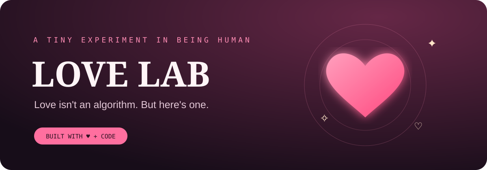

# Love Lab ❤️

<p align="center">
  
</p>

<p align="center">
  <strong>A playful, interactive love-themed web experience inspired by the original C program “Detect Love”.</strong>
</p>

<p align="center">
  
  
  
  
  
</p>

**Love Lab** grows from a simple programming question: “Do you love them, and do they love you?” The original C program approached that question with yes/no answers. The upgraded experience keeps the playful spirit while making room for the truth: feelings are personal, complicated, and cannot be calculated by software.

## ✨ Features

- **Feeling Finder** — choose a reflection that matches how you feel and get a gentle, non-judgmental response.
- **Personal love-note maker** — write a note using names and a detail you appreciate, then copy it to personalize and share.
- **Mood Garden** — choose from 12 emotions, including happy, hopeful, in love, grateful, missing someone, nervous, confused, sad, lonely, heartbroken, peaceful, and overwhelmed.
- **Personalized emotional support** — each mood offers a gentle, non-judgmental reflection and affirmation; copy it to keep or share.
- **Private feelings journal** — save mood check-ins and personal notes in your browser, review recent entries, or clear the journal. The app keeps up to 30 entries locally.
- **Personal love-note maker** — write a note using names and a detail you appreciate, then copy it to personalize and share.
- **Celebration effects** — animated hearts, sparkles, and a confetti surprise.
- **Responsive layout** — designed for phones, tablets, and desktop screens.
- **Accessible interactions** — keyboard-friendly controls, live result announcements, and reduced-motion support.
- **Privacy-minded by design** — no account, backend, analytics, or form submission. Journal entries are stored in this browser on this device, not sent to a server; anyone with access to the same browser profile may be able to view them.
- **No build step** — plain HTML, CSS, and JavaScript.

> This is a playful reflection tool, not a real love detector or a substitute for honest communication and consent.

## 🚀 Run it locally

No package manager or build tools are required.

1. Clone the repository:
   ```bash
   git clone https://github.com/ahsanibnewalid/Love.git
   cd Love
   ```
2. Open `index.html` in a modern browser.

For a local web server, run:
```bash
python3 -m http.server 8000
```
Then visit [http://localhost:8000](http://localhost:8000).

The decorative Google Fonts are optional; system fallbacks keep the interface usable if fonts cannot load.

## 🌐 Publish with GitHub Pages

1. Open the repository's **Settings → Pages**.
2. Under the build and deployment settings, choose **Deploy from a branch**.
3. Select the `main` branch and the `/ (root)` folder, then save.
4. After GitHub Pages finishes publishing, open the URL shown in Settings → Pages.

## 🧰 Original C program

The interactive C console program is available as `BrokenLove.c`. It now includes a four-option main menu, a four-outcome love check-in, 14 emotion reflections, a personalized love-note maker, and kind reminders. It validates menu and yes/no input and handles all combinations in the love check-in. The program is for reflection and fun; it cannot detect another person's feelings. Compile and run it with a C compiler such as GCC:

```bash
gcc BrokenLove.c -o broken-love
./broken-love
```

On Windows with GCC installed, run `broken-love.exe` after compiling. The browser experience is a separate, more interactive companion; it does not replace the original source file.

## 🛠️ Troubleshooting C compilation

If compilation reports errors such as `function definition is not allowed here` inside a system header like `SYSROOT/usr/include/ctype.h`, the header is usually not the real cause. The compiler may be interpreting the header as though it were included inside a function because of a syntax problem earlier in the source file.

Try these checks:

1. Make sure the standard headers are at the top of `BrokenLove.c`, outside every function:
   ```c
   #include <stdio.h>
   #include <ctype.h>
   #include <string.h>
   ```
2. Inspect the source lines immediately before the reported include line for a missing closing brace (`}`), an unfinished block comment (`/* ... */`), or an unmatched conditional-preprocessor directive.
3. Compile the complete `BrokenLove.c` file as C with GCC:
   ```bash
   gcc -std=c11 -Wall -Wextra BrokenLove.c -o broken-love
   ```
4. Do **not** edit files inside `SYSROOT` or the system's `ctype.h`. If the error persists, inspect the first error and the source file named in the diagnostic (for example, `default.c`) around the indicated line. Make sure you are compiling the intended source file and not an unrelated generated or wrapper file.

If you are compiling in an online IDE or Android compiler app, its generated file (such as `default.c`) may differ from `BrokenLove.c`. Check that the complete source was pasted correctly and that the tool is using a C compiler.

## 📁 Project structure

```text
Love/
├── assets/
│   └── love-lab-banner.svg
├── BrokenLove.c
├── index.html
├── LICENSE
└── README.md
```

## 🤝 Contributing

Ideas, bug reports, accessibility improvements, and thoughtful contributions are welcome. Please keep the project lightweight and respectful: the app should encourage reflection, never claim to know another person's feelings, and never pressure someone to return affection.

## 📜 License

Distributed under the [MIT License](LICENSE).

<p align="center">Made with ♥ and code.</p>
